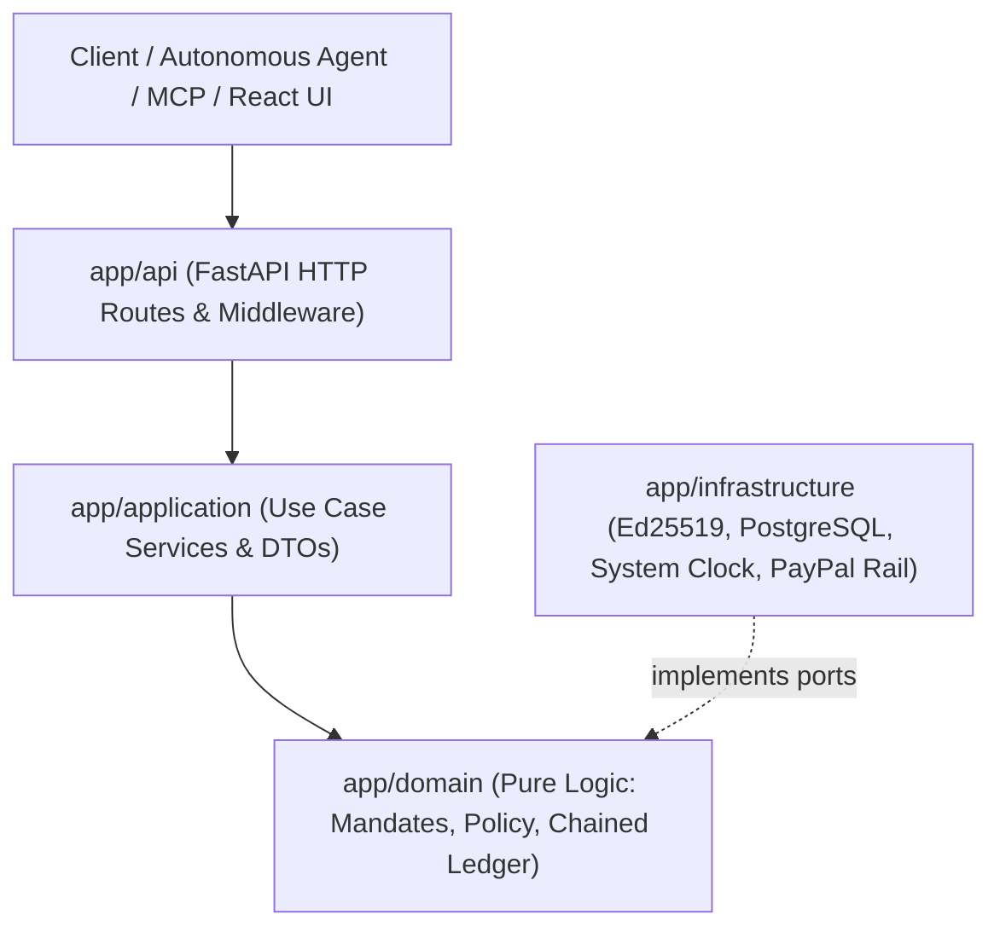

# ARCHITECTURE - System Architecture & Hexagonal Boundaries

PHALANX implements clean Hexagonal Architecture (Ports and Adapters) with strict architectural boundaries.



---

## 1. Architectural Invariants

### 1. Pure Domain Layer (`app/domain`)
- **Zero I/O**: The domain layer performs no file, network, database, or socket operations.
- **No System Clocks**: Current time is strictly UTC and injected from the application layer.
- **No Randomness**: Every evaluation function is 100% deterministic.
- **Zero External Dependencies**: `app/domain` imports nothing from `app/application`, `app/infrastructure`, or `app/api`. Enforced automatically by AST test `tests/unit/test_domain_purity.py`.

### 2. The LLM is Never in the Authorization Path
- The LLM can propose intents from unstructured text.
- The pure deterministic policy engine evaluates hard bounds.
- Advisory heuristics or ML risk scores can only tighten decisions (`ALLOW` -> `STEP_UP` -> `DENY`), never loosen them.

### 3. Cryptographic Sealing & Anti-Tampering
- **Mandates**: Signed using Ed25519 private keys (`cryptography.hazmat`). Any mutation to limits or payees invalidates the signature.
- **Approvals**: Bound to the SHA-256 digest of the canonical RFC 8785 JSON intent representation.
- **Audit Ledger**: Every event contains `prev_hash` and `event_hash = SHA256(prev_hash + canonical_json(payload))`. Any direct SQL tampering breaks the chain.

---

## 2. Directory Layout & Layer Responsibilities
```
app/
  domain/                 # Pure domain models, policy engine, hash chain, ports
    canonical_json.py     # RFC 8785 compliant canonical serializer
    mandates.py           # Mandate dataclass and signable dict generator
    models.py             # Money (minor units), TransactionIntent, DecisionOutcome
    policy.py             # evaluate_policy() deterministic engine
    ledger.py             # ChainedLedgerEvent and verify_chain()
    ports.py              # ClockPort, LedgerPort
  application/            # Orchestration layer, DTOs, safety validators
    dtos.py               # Strict Pydantic models (extra="forbid")
    services.py           # AuthorizationService, MandateService, LedgerService
    llm_proposer.py       # Heuristic scanner, grounded explanation validator
  infrastructure/         # Adapters implementing domain ports
    crypto.py             # Ed25519 keypair generation, hex signing & verification
    ledger.py             # Append-only ledger adapter with hash chaining
    paypal.py             # PaymentRail protocol & Sandbox adapter
    clock.py              # SystemUtcClock adapter
    database.py           # SQLAlchemy 2 database readiness
  api/                    # FastAPI HTTP routers, dependency injection
    routes.py             # REST endpoints (/v1/payment-requests, /v1/approvals, /v1/ledger)
    dependencies.py       # Service injection singletons
  mcp/                    # Model Context Protocol wrapper
    server.py             # PhalanxMcpServer
```
