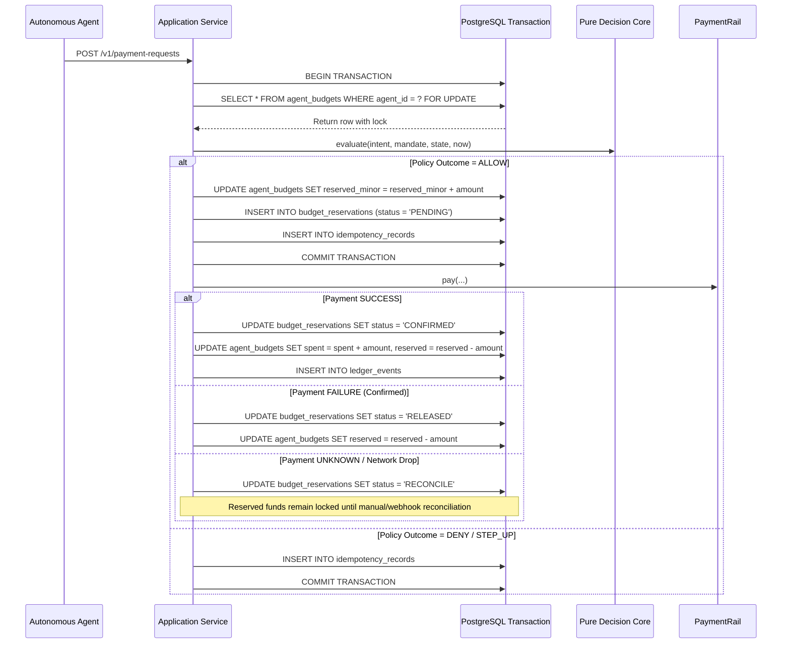

# DATABASE - Schema, Concurrency, and Ledger Immutability

Owner prompt: P4

---

## 1. Architectural Principles & Concurrency Model (Manual 56.12, 56.13, 56.14)

PHALANX guarantees **monetary safety around the pure decision core**. No financial transaction may be authorized or executed without prior atomic budget reservation inside an ACID database transaction.

### Core Invariants:
1. **Zero Read-Then-Write Outside a Transaction**: All budget checks and balance increments happen within a single database transaction using row-level locks (`SELECT ... FOR UPDATE` in PostgreSQL / atomic conditional reservation in SQLite).
2. **Never Release on UNKNOWN**: If a payment outcome is ambiguous, network drops, or a timeout occurs, reserved funds **remain locked** and the transaction state is set to `RECONCILE`. Release occurs strictly upon cryptographic proof of failure (e.g. verified webhook rejection).
3. **Idempotency with Mutation Detection**: Every transaction is bound to a unique `idempotency_key` and the SHA-256 canonical digest of the request payload. Replays return the cached decision; parameter mutations trigger immediate hard `DENY`.
4. **Append-Only Tamper-Evident Ledger**: Every event is cryptographically linked to the previous event (`event_hash = SHA-256(prev_hash + canonical_payload)`). Modifying or deleting any historical row breaks the cryptographic chain and triggers database-level trigger rejections.

---

## 2. Table Specifications

### 2.1 `agent_budgets`
Tracks cumulative spending and active reservations per agent mandate.

| Column | Type | Constraints | Description |
|---|---|---|---|
| `agent_id` | VARCHAR(128) | PRIMARY KEY | Unique identifier of the autonomous agent |
| `mandate_id` | VARCHAR(64) | NOT NULL | ID of the active Ed25519 mandate |
| `currency` | VARCHAR(3) | NOT NULL | 3-letter ISO-4217 currency code (e.g. 'USD') |
| `allocated_minor` | BIGINT | NOT NULL, >= 0 | Lifetime budget ceiling authorized by principal |
| `spent_minor` | BIGINT | NOT NULL, >= 0 | Total minor units settled and captured |
| `reserved_minor` | BIGINT | NOT NULL, >= 0 | In-flight active reservations pending execution |
| `created_at_utc` | TIMESTAMP | NOT NULL | Creation timestamp |
| `updated_at_utc` | TIMESTAMP | NOT NULL | Last update timestamp |

**Check Constraint**:
```sql
CONSTRAINT chk_budget_limit CHECK (spent_minor + reserved_minor <= allocated_minor);
```

---

### 2.2 `budget_reservations`
Maintains individual transaction reservations with atomic lifecycle tracking.

| Column | Type | Constraints | Description |
|---|---|---|---|
| `reservation_id` | VARCHAR(64) | PRIMARY KEY | Unique reservation ID |
| `idempotency_key` | VARCHAR(128) | UNIQUE, NOT NULL | Idempotency key from agent |
| `agent_id` | VARCHAR(128) | NOT NULL, FK to agent_budgets | Target agent |
| `amount_minor` | BIGINT | NOT NULL, > 0 | Amount reserved in minor units |
| `currency` | VARCHAR(3) | NOT NULL | Currency code |
| `status` | VARCHAR(32) | NOT NULL | `PENDING`, `CONFIRMED`, `RELEASED`, `RECONCILE` |
| `created_at_utc` | TIMESTAMP | NOT NULL | Creation timestamp |
| `updated_at_utc` | TIMESTAMP | NOT NULL | Last state change timestamp |

---

### 2.3 `idempotency_records`
Caches evaluation decisions to prevent double-spend attacks (Manual 56.14).

| Column | Type | Constraints | Description |
|---|---|---|---|
| `idempotency_key` | VARCHAR(128) | PRIMARY KEY | Agent idempotency identifier |
| `agent_id` | VARCHAR(128) | NOT NULL | Requesting agent ID |
| `intent_digest` | VARCHAR(64) | NOT NULL | SHA-256 hex digest of RFC 8785 canonical intent |
| `decision` | VARCHAR(16) | NOT NULL | `ALLOW`, `STEP_UP`, `DENY` |
| `response_payload` | TEXT | NOT NULL | Serialized JSON response returned to caller |
| `created_at_utc` | TIMESTAMP | NOT NULL | Creation timestamp |

---

### 2.4 `step_up_approvals`
Binds human supervisor step-up authorizations to the cryptographic digest of the original intent.

| Column | Type | Constraints | Description |
|---|---|---|---|
| `request_id` | VARCHAR(64) | PRIMARY KEY | Unique step-up request ID |
| `idempotency_key` | VARCHAR(128) | NOT NULL | Associated transaction idempotency key |
| `expected_digest` | VARCHAR(64) | NOT NULL | SHA-256 digest of original intent |
| `intent_payload` | TEXT | NOT NULL | Serialized RFC 8785 intent parameters |
| `status` | VARCHAR(32) | NOT NULL | `PENDING`, `APPROVED`, `REJECTED`, `EXPIRED` |
| `expires_at_utc` | TIMESTAMP | NOT NULL | Human review expiration window |
| `decision` | VARCHAR(16) | NULL | Final approved/rejected decision |
| `approver_id` | VARCHAR(128) | NULL | Identity of approving operator |
| `created_at_utc` | TIMESTAMP | NOT NULL | Creation timestamp |
| `updated_at_utc` | TIMESTAMP | NOT NULL | Resolution timestamp |

---

### 2.5 `ledger_events`
Cryptographically chained audit trail. Protected from in-place updates or deletions.

| Column | Type | Constraints | Description |
|---|---|---|---|
| `event_id` | VARCHAR(64) | PRIMARY KEY | Monotonic unique event ID (`evt_000001_...`) |
| `event_seq` | BIGINT | NOT NULL | Strictly increasing sequence index (1, 2, 3...) |
| `prev_hash` | VARCHAR(64) | NOT NULL | Hash of previous event (`0`*64 for genesis) |
| `event_hash` | VARCHAR(64) | NOT NULL, UNIQUE | SHA-256(prev_hash + canonical_payload) |
| `event_type` | VARCHAR(64) | NOT NULL | `TRANSACTION.AUTHORIZED`, `STEP_UP.REQUESTED`, etc. |
| `agent_id` | VARCHAR(128) | NOT NULL | Acting agent ID |
| `recipient_id` | VARCHAR(128) | NOT NULL | Payee recipient ID |
| `amount_minor` | BIGINT | NOT NULL | Amount in integer minor units |
| `currency` | VARCHAR(3) | NOT NULL | 3-letter currency code |
| `payload_json` | TEXT | NOT NULL | RFC 8785 canonical JSON payload |
| `recorded_at_utc` | TIMESTAMP | NOT NULL | Timestamp of ledger write |

---

## 3. Immutability Protection & Triggers

To enforce database-level immutability on `ledger_events`:
1. **Engine Privilege Revocation**: The PostgreSQL application role `phalanx_app` is granted `SELECT` and `INSERT` privileges only. `UPDATE`, `DELETE`, and `TRUNCATE` are revoked.
2. **Database Triggers**:
   - PostgreSQL Trigger:
     ```sql
     CREATE OR REPLACE FUNCTION deny_ledger_mutation()
     RETURNS TRIGGER AS $$
     BEGIN
         RAISE EXCEPTION 'ledger_events is append-only: updates and deletes are strictly prohibited';
     END;
     $$ LANGUAGE plpgsql;

     CREATE TRIGGER trg_deny_ledger_mutation
     BEFORE UPDATE OR DELETE ON ledger_events
     FOR EACH ROW EXECUTE FUNCTION deny_ledger_mutation();
     ```
   - SQLite Compatibility Trigger:
     ```sql
     CREATE TRIGGER trg_no_update_ledger BEFORE UPDATE ON ledger_events
     BEGIN
         SELECT RAISE(ABORT, 'ledger_events is append-only: updates prohibited');
     END;

     CREATE TRIGGER trg_no_delete_ledger BEFORE DELETE ON ledger_events
     BEGIN
         SELECT RAISE(ABORT, 'ledger_events is append-only: deletes prohibited');
     END;
     ```

---

## 4. Concurrency & Locking Strategy (Manual 56.13)

### 4.1 Single-Transaction Reservation Algorithm


---

## 5. Migration Strategy (Manual 56.12)
- Managed via **Alembic** (`alembic/versions/`).
- Forward (`upgrade`) and rollback (`downgrade`) are verified by automated tests running against fresh database instances.
