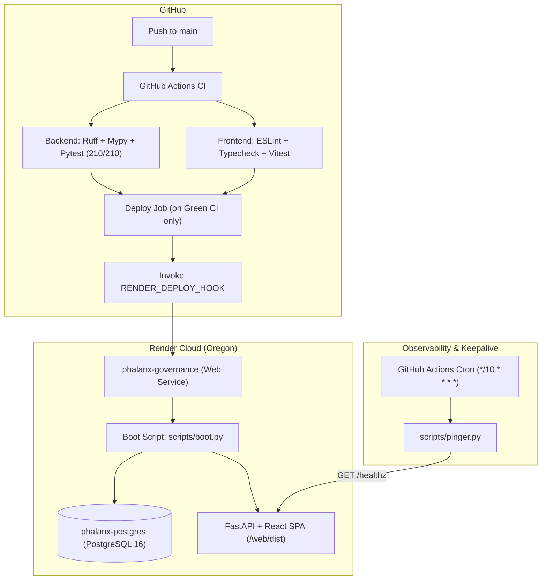

# DEPLOYMENT - Production Infrastructure & Deployment Guide

## 1. Overview & Hosting Architecture

PHALANX is hosted on **Render** using a unified Infrastructure-as-Code Blueprint ([`render.yaml`](file:///d:/PHALANX/render.yaml)) supporting continuous deployment, automated schema migrations, and idempotent data seeding.

---

## 2. Render Blueprint Specification (`render.yaml`)

The deployment defines two core managed resources:
1. **Web Service (`phalanx-governance`)**:
   - **Runtime**: Python 3.12 with `uv` package manager and Node.js Vite frontend compilation.
   - **Build Command**: `pip install uv && uv sync && cd web && npm ci && npm run build`
   - **Start Command**: `uv run python scripts/boot.py && uv run uvicorn app.main:app --host 0.0.0.0 --port $PORT`
   - **Health Check Path**: `/healthz`
   - **Static Serving**: FastAPI natively mounts `/web/dist` at `/`, serving the React SPA and API from a single origin.
2. **Managed PostgreSQL Database (`phalanx-postgres`)**:
   - **Database Name**: `phalanx_db`
   - **Database User**: `phalanx_app`
   - **Plan**: `starter` ($7/mo recommended for judging survival) or `free`.

---

## 3. Render Tier Analysis & Demo Survival (1 to 15 Dec 2026)

### 3.1 Free-Tier Limitations
- **Web Service Sleep Rule**: Render Free Web Services sleep after **15 minutes of inactivity**. Cold boots take 30 to 50 seconds to wake.
  - **Mitigation**: Automated keepalive cron job in [`.github/workflows/keepalive.yml`](file:///d:/PHALANX/.github/workflows/keepalive.yml) triggers [`scripts/pinger.py`](file:///d:/PHALANX/scripts/pinger.py) every 10 minutes (`*/10 * * * *`), keeping the instance warm throughout judging.
- **PostgreSQL Database Expiry Rule**: Free PostgreSQL databases on Render **expire 30 days after creation and are permanently deleted**.
  - **Impact on Demo**: A free database provisioned in October or November will be deleted before or during the hackathon judging period (1 to 15 Dec 2026).
  - **Recommended Production Fix**: Provision the database under the **Starter Plan** ($7/month). Starter databases never expire, operate continuously, and provide persistent SSD storage.
  - **Alternative Free Fix**: Configure `DATABASE_URL` pointing to persistent managed PostgreSQL (e.g. Supabase or Neon persistent tier).
  - **Resilience**: Even if a database is wiped or reprovisioned, [`scripts/boot.py`](file:///d:/PHALANX/scripts/boot.py) automatically restores tables, triggers, demo mandates (valid until 2027-03-31), payees, and ledger genesis blocks.

---

## 4. Idempotent Boot Sequence (`scripts/boot.py`)

Every container start or restart executes [`scripts/boot.py`](file:///d:/PHALANX/scripts/boot.py) prior to starting Uvicorn:
1. **Schema Creation**: Executes table creation and database-level triggers enforcing append-only immutability on `ledger_events` (blocks `UPDATE` and `DELETE`).
2. **Demo Mandate Seeding**:
   - Mandate ID: `mandate_default_astra`
   - Principal: `org_astra_corp`
   - Agent: `agent-auto-1`
   - Validity Window: Start UTC now, Expiry **no earlier than 31 Mar 2027** (`2027-03-31T23:59:59Z`).
   - Single Transaction Limit: $1,000.00 (`100000` minor units).
   - Daily Limit: $2,500.00 (`250000` minor units).
   - Lifetime Budget: $10,000.00 (`1000000` minor units).
   - Allowed Payees: `vendor-paypal-sandbox-1`, `payee_office_supplies`, `payee_cloud_compute`, `vendor_hardware_direct`.
   - Integrity Seal: Cryptographically signed with Ed25519 private key.
3. **Supervisor Step-Up Queue Seeding**:
   - Request ID: `req_stepup_1001`
   - Amount: $1,200.00 (`120000` minor units)
   - Reason: Equipment invoice requiring human supervisor review (bound to SHA-256 canonical digest).
4. **Idempotency Guarantee**: All SQL operations use existence checks (`SELECT 1`) or conflict guards to avoid duplicate row insertion on subsequent restarts.

---

## 5. Continuous Deployment & Post-Deploy Smoke Testing

### 5.1 Deployment Pipeline
- Deployments to production occur **only on pushes to `main` and only after all CI checks pass**:
  - `backend-checks`: Ruff linting, Ruff formatting, Mypy type-checking, 210 Pytest tests, 60 Red Team attack cases.
  - `frontend-checks`: ESLint, TypeScript check (`tsc --noEmit`), Vitest suite, Vite production build.
- The `deploy` job triggers Render via `curl -f -X POST "$RENDER_DEPLOY_HOOK"`.
- Secrets configured in GitHub Repository Settings:
  - `RENDER_DEPLOY_HOOK`: Secret webhook URL provided by Render.
  - `PHALANX_TARGET_URL`: Hosted service URL (e.g., `https://phalanx-governance.onrender.com`).
  - `PHALANX_ADMIN_TOKEN`: Secret administrative token for remote demo resets.

### 5.2 Post-Deploy Smoke Test (`scripts/post_deploy_smoke.py`)
Following rollout, the automated smoke runner executes:
- **Scene 0**: Admin Reset via `POST /v1/admin/reset` with `X-Admin-Token`.
- **Scene 1**: Autonomous Agent Request Console ($15.00 cloud hosting -> instant `ALLOW` decision -> hash-chained ledger event).
- **Scene 2**: Human Supervisor Approval Queue (retrieves `req_stepup_1001`, computes expected canonical digest, executes approval -> `ALLOW`).
- **Scene 3**: Audit Ledger (verifies pristine SHA-256 chain -> injects simulated auditor tamper -> verifies tamper detection -> restores chain).

---

## 6. PayPal Sandbox Longevity Verification

| Credential / Artifact | Expiration / Lifespan | Survival Through 15 Dec 2026 | Verification Proof |
| :--- | :--- | :--- | :--- |
| **Sandbox Client ID & Secret** | Indefinite (No expiry) | **Verified** | PayPal Developer Portal: credentials remain active until manually rotated. |
| **Vault Payment Tokens** | Indefinite | **Verified** | PayPal Vault v3 API documentation: sandbox tokens do not expire. |
| **OAuth Bearer Tokens** | 32,400 seconds (9 hours) | **Verified** | Automatically refreshed on-demand by `PayPalPaymentRailAdapter`. |
| **Demo Mandate** | Valid until 31 Mar 2027 | **Verified** | Hardcoded check ensures `valid_until >= 2027-03-31T23:59:59Z`. |
