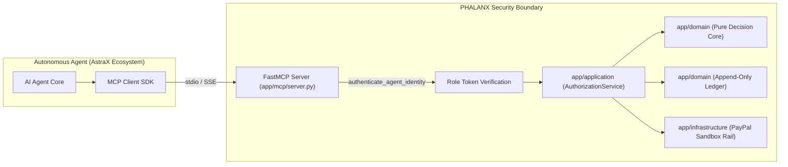

# MCP Integration - Model Context Protocol for Autonomous Agents

## 1. Overview & Architecture

PHALANX exposes autonomous financial governance tools to AI agents using the **official Python MCP SDK (`mcp`)**.



### Architectural Invariants:
1. **Strict Layering**: Every MCP tool invocation routes strictly through `app/application` services. No side doors or direct database/rail access exist.
2. **Client Identity**: The client must authenticate as an **Agent identity** (`Role.AGENT`). Principals and Approvers cannot use MCP to authorize payments, and Agents can never approve transactions.
3. **Reference-Only Responses**: MCP returns deterministic decisions (`ALLOW`, `STEP_UP`, `DENY`), human review request references (`req_...`), and canonical digests.
4. **Zero Credential Exposure**: No private signing keys, PayPal secrets, or database URLs are ever returned or accessible via MCP.

---

## 2. Exposed MCP Tools

### `request_payment`
Submits an autonomous financial transaction for deterministic policy evaluation.

**Arguments**:
- `agent_id` (str): Identifier of the autonomous agent making the request.
- `recipient_id` (str): Recipient identifier / PayPal sandbox merchant account.
- `amount_minor` (int): Monetary amount in integer minor units ($15.00 = `1500`).
- `currency` (str): 3-letter ISO-4217 currency code (e.g., `"USD"`).
- `purpose` (str): Plain-text business justification.
- `idempotency_key` (str): Unique request key to prevent duplicate debits.
- `invoice_reference` (str, optional): Verified PO or invoice reference.
- `auth_token` (str, optional): Short-lived signed role token (defaults to `demo-agent` in development).

**Response**:
```json
{
  "request_id": "req_1905d31e619421a7",
  "decision": "ALLOW",
  "reasons": ["Pre-authorized transaction within mandate parameters"],
  "reason_codes": [],
  "intent_digest": "48a2...",
  "payout_id": "sandbox_tx_00000001",
  "evaluated_at_utc": "2026-10-22T22:21:37.000000+00:00"
}
```

### `get_mandate_status`
Queries active spending limits, remaining lifetime budget, and validity windows.

**Arguments**:
- `mandate_id` (str): The identifier of the mandate (e.g., `"mandate_default_astra"`).
- `auth_token` (str, optional): Signed agent role token.

**Response**:
```json
{
  "mandate_id": "mandate_default_astra",
  "version": 1,
  "status": "ACTIVE",
  "single_limit_minor": 500000,
  "instant_threshold_minor": 50000,
  "lifetime_budget_minor": 2500000,
  "spent_budget_minor": 0,
  "remaining_budget_minor": 2500000,
  "currency": "USD",
  "allowed_payees": ["vendor-paypal-sandbox-1", "payee_office_supplies", "payee_cloud_compute"],
  "allowed_purposes": ["Monthly cloud hosting", "Equipment invoice review"],
  "valid_from_utc": "2026-10-22T00:00:00+00:00",
  "valid_until_utc": "2027-03-31T23:59:59+00:00"
}
```

---

## 3. AstraX Example Client Implementation

See [`examples/astrax_mcp_client.py`](file:///d:/PHALANX/examples/astrax_mcp_client.py) for the complete executable client:

```bash
uv run python examples/astrax_mcp_client.py
```

---

## 4. Security Verification & Threat Mitigations

- **Catalog G1 (No Alternate Path)**: Agents cannot bypass policy evaluation because MCP calls the exact same `AuthorizationService.authorize()` pipeline as HTTP `/v1/payment-requests`.
- **Zero Approval Capability**: There is no `approve_payment` tool exposed over MCP. Step-up exceptions MUST be approved by a human supervisor through the authenticated human console or REST API.
- **Decision Parity**: Identical payment requests submitted via MCP and HTTP yield bit-identical decisions, reason codes, digests, and hash-chained ledger events.
