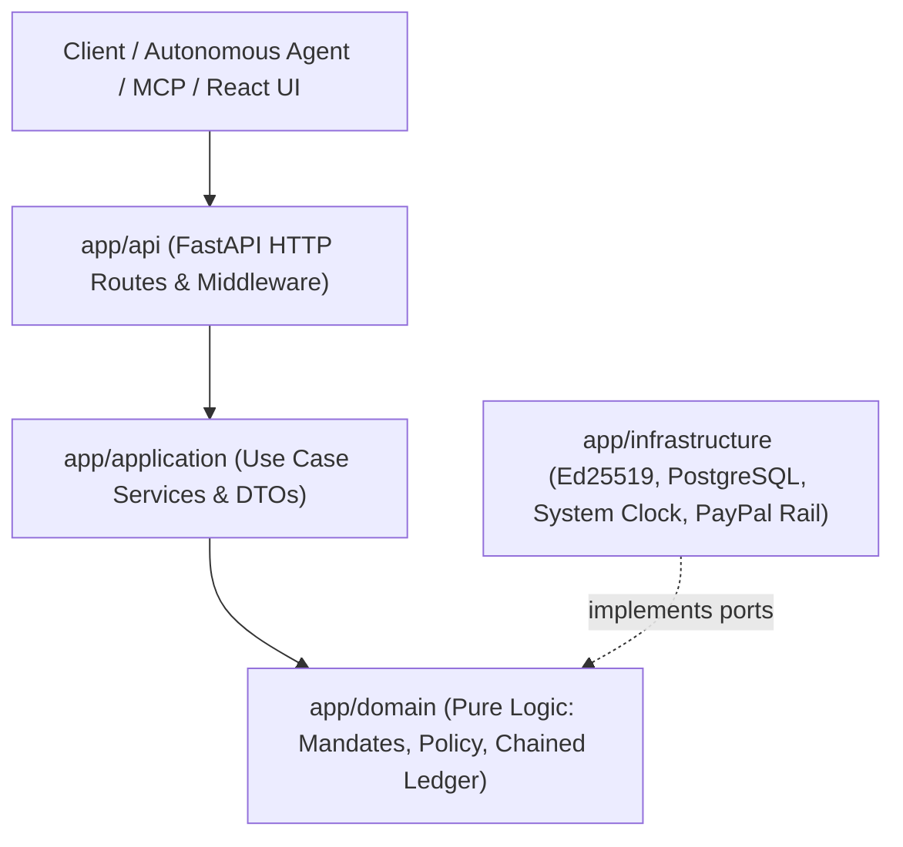

# System Architecture & Hexagonal Boundaries

PHALANX implements Hexagonal Architecture (Ports and Adapters) with boundaries separating pure domain rules, orchestration, persistence, and external payment rails.



---

## 1. Architectural Invariants

### 1.1 Pure Domain Layer (`app/domain`)
- **Zero I/O**: The domain layer performs no file, network, database, or socket operations.
- **No System Clocks**: Current time is strictly UTC and injected from the application layer.
- **No Randomness**: Every evaluation function is deterministic.
- **Zero Outer Imports**: `app/domain` imports nothing from `app/application`, `app/infrastructure`, or `app/api`. Enforced automatically by AST test `tests/unit/test_domain_purity.py`.

### 1.2 The LLM is Never in the Authorization Path
- The LLM can propose intents from unstructured text.
- The pure deterministic policy engine evaluates hard bounds.
- Advisory heuristics or ML risk scores can only tighten decisions (`ALLOW` -> `STEP_UP` -> `DENY`), never loosen them.

### 1.3 Cryptographic Sealing & Anti-Tampering
- **Mandates**: Signed using Ed25519 private keys (`cryptography.hazmat`). Any mutation to limits or payees invalidates the signature.
- **Approvals**: Bound to the SHA-256 digest of the canonical RFC 8785 JSON intent representation.
- **Audit Ledger**: Every event contains `prev_hash` and `event_hash = SHA256(prev_hash + canonical_json(payload))`. Any direct SQL tampering breaks the chain.

---

## 2. Directory Layout & Layer Responsibilities

```
app/
  domain/                 # Pure domain models, policy engine, hash chain, ports
    canonical_json.py     # RFC 8785 compliant canonical serializer
    mandates.py           # Mandate dataclass and signable dict generator
    models.py             # Money (minor units), TransactionIntent, DecisionOutcome
    policy.py             # evaluate_policy() deterministic engine
    ledger.py             # ChainedLedgerEvent and verify_chain()
    ports.py              # ClockPort, LedgerPort, PaymentRail
  application/            # Orchestration layer, DTOs, safety validators
    dtos.py               # Strict Pydantic models (extra="forbid")
    services.py           # AuthorizationService, MandateService, LedgerService
    llm_proposer.py       # Heuristic scanner, grounded explanation validator
    advisory_signals.py   # HeuristicRiskScanner, VelocityAnomalyDetector, Classifier
  infrastructure/         # Adapters implementing domain ports
    crypto.py             # Ed25519 keypair generation, hex signing & verification
    db_ledger_repo.py     # Append-only database ledger adapter with hash chaining
    db_budget_repo.py     # PostgreSQL atomic balance reservation repository
    paypal.py             # PaymentRail protocol & Sandbox adapter
    clock.py              # SystemUtcClock adapter
    database.py           # SQLAlchemy 2 database engine and readiness
    tokens.py             # HMAC-SHA256 role tokens
  api/                    # FastAPI HTTP routers, dependency injection
    routes.py             # REST endpoints (/v1/payments, /v1/approvals, /v1/ledger)
    dependencies.py       # Service injection singletons
    auth.py               # Bearer token verification and role checking
  mcp/                    # Model Context Protocol wrapper
    server.py             # FastMCP server exposing tools to agent clients
```

---

## 3. Database Schema & State Isolation

PostgreSQL is mandatory outside unit test execution:

1. `ledger_events`: Append-only audit journal. App role has `INSERT` and `SELECT` permissions only (`UPDATE` and `DELETE` are revoked). Stores `event_seq`, `event_id`, `prev_hash`, `event_hash`, and canonical JSON payload.
2. `agent_budgets`: Tracks agent lifetime budget, rolling 24-hour spent amounts, and active reservations.
3. `budget_reservations`: Row-level locked balance reservations (`PENDING`, `CONFIRMED`, `RELEASED`) preventing concurrent double-spends.
4. `step_up_approvals`: Queue for transactions exceeding autonomous limits. Stores RFC 8785 canonical intent digest to prevent parameter swap during supervisor review.
5. `idempotency_records`: Stores idempotency keys mapped to intent digests and responses to guarantee at-most-once payment execution.

---

## 4. Model Context Protocol (MCP) Interface

Autonomous agents interface with PHALANX through the official Python MCP SDK (`mcp`):
- `request_payment`: Propose an intent for policy evaluation.
- `get_mandate_status`: Inspect assigned spending limits and allowed payees.
- `verify_ledger`: Check the audit hash chain integrity.
All MCP tool calls route through identical application authorization checks (`AuthorizationService`) as HTTP requests.

---

## 5. Web Console

Built with React 19, TypeScript, and Vite. Features 7 views:
1. **Home**: Overview metrics and recent activity stream.
2. **Pay**: Request console with scenario presets and instant evaluation badge.
3. **Approvals**: Step-up queue with diff inspection and RFC 8785 digest binding.
4. **Activity**: Ledger journal, windowed visual block strip, and receipt links.
5. **Mandates**: Ed25519 limits and budget meters.
6. **Attack Lab**: Threat vectors with interactive execution trigger.
7. **Receipt & Verify**: Cryptographic receipt cards and public SHA-256 verifier.
